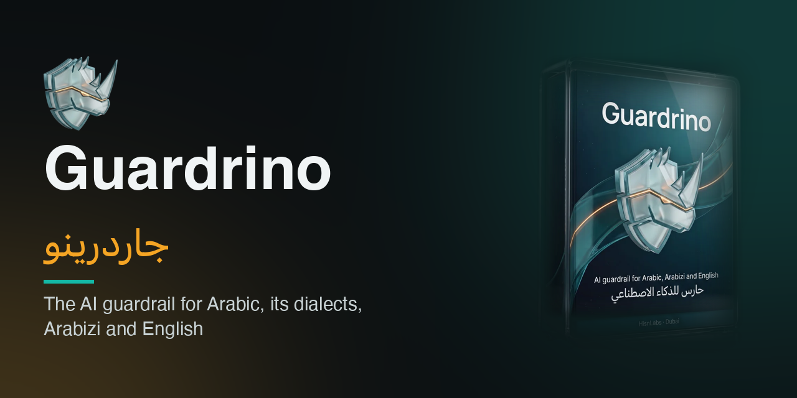
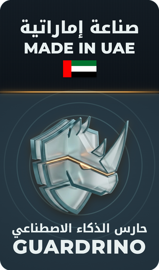
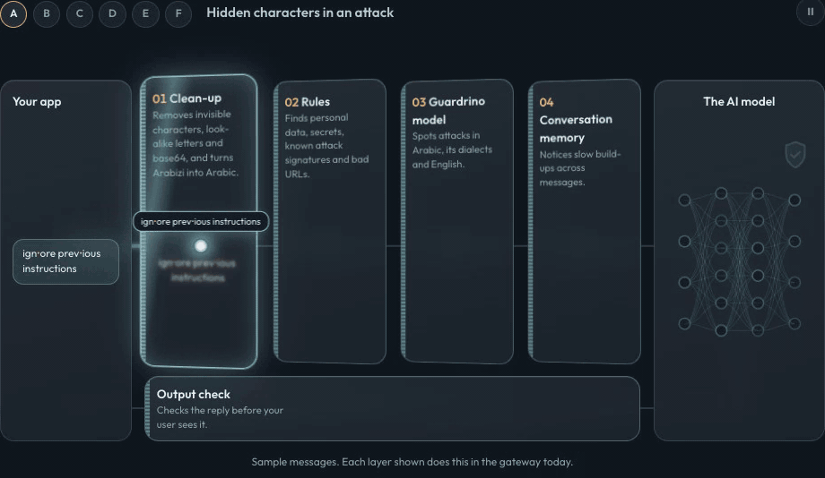
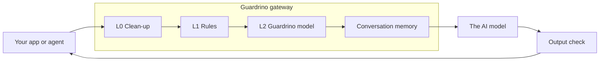

<p align="center">
  
</p>

<p align="center">
  <a href="https://github.com/HisnLabs/Guardrino/actions/workflows/test.yml"></a>
  <a href="https://github.com/HisnLabs/Guardrino/releases/latest"></a>
  <a href="https://github.com/HisnLabs/Guardrino/stargazers"></a>
  <a href="https://hisnlabs.com/guardrino/en"></a>
  <a href="LICENSE"></a>
  <a href="https://huggingface.co/Hisnlabs"></a>
  <a href="https://hisnlabs.com/guardrino/en"></a>
  <a href="https://huggingface.co/spaces/Hisnlabs/guardrino-demo"></a>
</p>

<p align="center">
  <b>Works with</b> &nbsp; OpenAI-compatible API &middot; SSE streaming &middot; LiteLLM &middot; MCP &middot; Python &middot; Rust
  <br><sub>PyPI package: coming soon</sub>
</p>

# Guardrino



Guardrino is a guard between your company and every AI model. It reads each message on its way in and each reply on its way out, and it was built for Arabic (Gulf, Levantine, Egyptian and Moroccan dialects), Arabizi (Arabic in Latin letters) and English from day one.

> **What is in this repository.** The integrations and examples you need to connect your stack to Guardrino. The Guardrino gateway itself is a commercial product and is **not** part of this repository. [Ask for a demo](#ask-for-a-demo).

<p align="center">
  
  <br><sub>Sample messages. Each layer shown does this in the gateway today.</sub>
</p>

## What HisnLabs offers

| | What you get | How |
|---|---|---|
| 🛡️ **Guardrino Gateway** (commercial) | The security gateway between your apps or AI agents and any model: inspect API, OpenAI-compatible proxy with streaming checks, LiteLLM plugin, MCP security proxy; clean-up, rules, the Guardrino model, conversation memory and output checks; admin console; on-premises or UAE cloud | A demo, then a watch-only trial on your own traffic. Pricing on request: a subscription that includes model and signature updates. **contact@hisnlabs.com** |
| 🔓 **Open source** (Apache-2.0) | The `guardrino-litellm` plugin and the integration examples in this repo; **Guardrino-t7 Open v3**, an earlier compact classifier ([release](https://github.com/HisnLabs/Guardrino/releases/tag/v3.0.0), [Hugging Face](https://huggingface.co/Hisnlabs/guardrino-t7-open)) | Free: clone, install, try |
| 🤝 **Services** | Deployment, per-app policies, a trial report of what Guardrino would have blocked, support, continuous updates | With the gateway |

## How it works



Every message is cleaned of disguises (L0), checked against rules, secrets, personal data and known attack signatures (L1), then judged by a model trained on Arabic and English (L2). A separate conversation-memory layer follows the scores across the whole dialogue and steps in when an attack is built slowly over several messages. The reply is checked on the way back before your user sees it.

## Built for the Gulf

| Strength | What it means for you |
|---|---|
| Arabic, its dialects and Arabizi | Trained on real Gulf, Levantine, Egyptian and Moroccan text, and on Arabic written in Latin letters. |
| Your data stays in the country | Runs inside your network or in a UAE cloud. Your messages never leave the country. |
| Conversation memory | Follows the whole conversation and steps in when an attack is built slowly across several messages. |
| Disguises undone first | Invisible characters, look-alike letters, base64 and Arabizi are cleaned up before a message is judged. |
| Canary tokens | A secret marker in your system prompt: any reply that leaks it is blocked and raises an alert. |
| Same-day signatures | A newly confirmed attack joins the signature list and is blocked the same day, between model updates. |
| Built to frustrate probing | Minimal answers, uniform timing, rate limits and cooldowns give automated attack tools as little as possible to learn from. |
| Gulf personal data | Recognises and masks Emirates ID, iqama, IBAN, local phone numbers, API keys and other secrets. |
| Watch first, then enforce | Start in watch-only mode with a full audit log, then switch to blocking app by app. |

## Quick start

**LiteLLM plugin, 3 steps** ([details](integrations/litellm))

1. Install the plugin on your LiteLLM server: `pip install "litellm[proxy]" ./integrations/litellm` (PyPI package coming soon).
2. Add Guardrino to your LiteLLM `config.yaml`: one guardrail before the model call and one after it.

```yaml
guardrails:
  - guardrail_name: guardrino-input
    litellm_params:
      guardrail: guardrino_litellm.GuardrinoGuardrail
      mode: pre_call            # checks the user's message (and tool results) before the model
      default_on: true
      api_base: os.environ/GUARDRINO_URL
      tenant: your-company
      app: support-bot
      fail_open: true           # Guardrino unreachable → traffic passes (false: refuse)
  - guardrail_name: guardrino-output
    litellm_params:
      guardrail: guardrino_litellm.GuardrinoGuardrail
      mode: post_call           # checks the model's reply before your user sees it
      default_on: true
      api_base: os.environ/GUARDRINO_URL
      tenant: your-company
      app: support-bot
      fail_open: true
```

3. Set your Guardrino gateway's address and LiteLLM's key, then start it:

```sh
export GUARDRINO_URL=https://guardrino.your-company.example
export LITELLM_MASTER_KEY=sk-your-litellm-key
litellm --config config.yaml
```

A full working file, with a model list, is in [`integrations/litellm/config.yaml`](integrations/litellm/config.yaml).

**OpenAI-compatible proxy, 2 steps** ([examples](examples))

1. Point your client's base URL at `https://guardrino.your-company.example/v1`.
2. Send the same requests as before. Blocked ones return a clear `guardrino_blocked` error.

```python
from openai import OpenAI
client = OpenAI(base_url="https://guardrino.your-company.example/v1", api_key="...")
```

More: [streaming (SSE)](examples/streaming-sse), [MCP security proxy](examples/mcp), [LiteLLM, both options](examples/litellm).

## بالعربية

جاردرينو حارس بين شركتك وكل نموذج ذكاء اصطناعي. يفحص كل رسالة قبل وصولها إلى النموذج وكل رد قبل وصوله إلى المستخدم، وقد صُمّم منذ البداية للعربية ولهجاتها الخليجية والشامية والمصرية والمغربية، وللعربيزي (العربية المكتوبة بحروف لاتينية) وللإنجليزية. تبقى بياناتك داخل شبكتك أو في سحابة داخل الإمارات. البوابة منتج تجاري غير مضمّن في هذا المستودع، وهذا المستودع يضم أدوات الربط والأمثلة.

## Ask for a demo

See Guardrino on your own traffic. Write to **[contact@hisnlabs.com](mailto:contact@hisnlabs.com)**.

## Links

- Website: <https://hisnlabs.com/guardrino/en>
- Integrations and examples: [integrations/](integrations), [examples/](examples)
- Hugging Face: <https://huggingface.co/Hisnlabs>
- Live demo: <https://huggingface.co/spaces/Hisnlabs/guardrino-demo>

## License

Apache-2.0, Copyright 2026 HisnLabs. See [LICENSE](LICENSE). This applies to the code in this repository, not to the commercial gateway.

---

<p align="center">
  <b>If Guardrino helps you protect AI in the Gulf, give the repo a ⭐: it helps other teams find it.</b><br>
  <sub>Made in Dubai by <a href="https://hisnlabs.com">HisnLabs</a> · <a href="https://hisnlabs.com/guardrino/en">hisnlabs.com/guardrino</a> · <a href="https://x.com/hisnlabs">X</a> · <a href="https://www.instagram.com/hisnlabs">Instagram</a> · <a href="https://www.youtube.com/@Hisnlab">YouTube</a> · <a href="https://www.reddit.com/u/HisnLabs/">Reddit</a> · contact@hisnlabs.com</sub>
</p>
